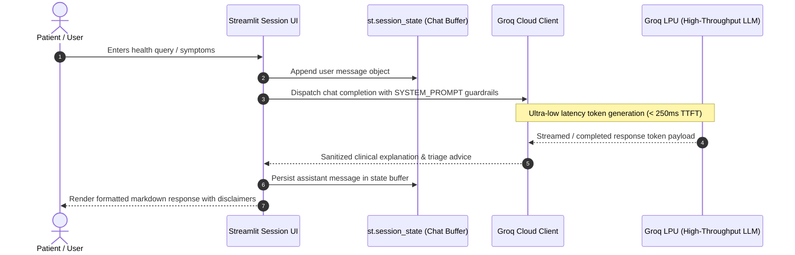

# Health Assistant AI — Groq LPU Powered Clinical Q&A

[](https://www.python.org/)
[](https://streamlit.io/)
[](https://groq.com/)
[](https://opensource.org/licenses/MIT)

A lightweight, low-latency conversational AI health assistant built on **Streamlit** and powered by the **Groq LPU™ Inference Engine**. The system delivers instantaneous, context-aware health guidance with strict guardrails against autonomous medical diagnosis and prescriptive pharmacology.

---

## 🏛️ System Architecture



---

## 🛡️ Clinical Guardrails & System Prompts

The assistant operates under strict ethical and safety directives defined in the core system prompt:
1. **Scope Boundary**: Rejects out-of-domain queries and focuses exclusively on human health, wellness, and medical terminology clarification.
2. **Non-Prescriptive Constraint**: Explicitly prohibited from issuing drug dosages, prescriptions, or definitive medical diagnoses.
3. **Emergency Escalation Protocol**: Detects severe symptom indicators (e.g., chest pain, shortness of breath, acute neurological deficits) and directs the user to immediate emergency medical care (911 / 112 / local ER).
4. **Accessible Communication**: Converts complex biomedical jargon into patient-friendly, plain-language insights.

---

## 📂 Repository Structure

```text
health-assistant-streamlit/
├── .gitignore              # Ignores .env, __pycache__, and venv
├── app.py                  # Main Streamlit application & Groq API client
└── requirements.txt        # Minimal production dependency manifest
```

---

## 🚀 Getting Started

### Prerequisites
- Python 3.10 or higher
- A free [Groq Cloud API Key](https://console.groq.com/keys)

### 1. Clone & Setup Environment
```bash
git clone https://github.com/ak-bharadwaj/health-assistant-streamlit.git
cd health-assistant-streamlit

# Create and activate virtual environment
python -m venv venv
source venv/bin/activate  # On Windows: .\venv\Scripts\activate

# Install dependencies
pip install -r requirements.txt
```

### 2. Configure Environment Variables
Create a `.env` file in the project root:
```env
GROQ_API_KEY=gsk_your_actual_groq_api_key_here
```

### 3. Launch the Application
```bash
streamlit run app.py
```
Open your browser at `http://localhost:8501`.

---

## 🌐 Cloud Deployment (Streamlit Community Cloud)

1. Fork or push this repository to your GitHub account.
2. Connect your repository to [Streamlit Community Cloud](https://share.streamlit.io/).
3. In **App Settings** > **Secrets**, add your API key:
   ```toml
   GROQ_API_KEY = "gsk_your_actual_groq_api_key_here"
   ```
4. Deploy with automatic CI/CD triggers on every commit.
